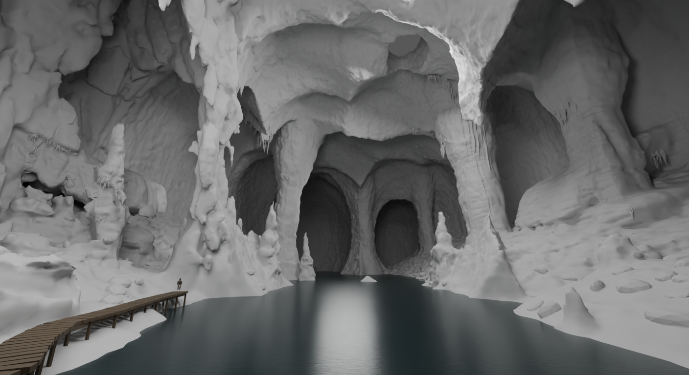
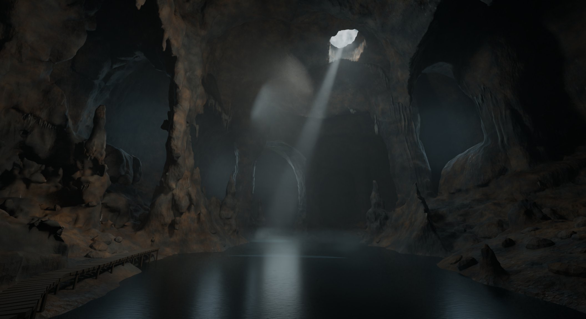

# Nodevember — The Sunken Cathedral

A work-in-progress procedural cavern study for **Nodevember 2026**, made in Blender using Geometry Nodes, procedural materials and compositor nodes.

## Open the project

Download or clone this repository, then open **[scene/nodevember-cavern.blend](scene/nodevember-cavern.blend)** in **Blender 5.3.0**.

```sh
git clone https://github.com/Maix31/nodevember.git
```

The `.blend` contains the editable node systems, camera, lighting and packed viewing references. Rendering does not require the authoring scripts, an automation bridge, external image textures or add-ons. Python was used to assemble and revise nodes during development.

Start with a low render resolution and a single Blender process. The scene is geometry-heavy; the saved full-resolution settings are intended for the eventual final still.

## Current geometry

The latest saved scene includes **NV13 fractured bedding and chipped edges on the left and right framing cliffs**. The current clay images show those changes without rock bump:



[Left foreground detail](previews/current-left-detail-clay.png)

## Earlier lighting proof

This lit image **predates the latest NV13 strata**. It shows the established composition, material hierarchy and lighting direction; it is not a current final render.



## What is procedural

- One connected structural rock field, hollowed into branching chambers, with node-generated banks and pinnacles.
- Local planar fractures, smaller interrupted rock strata and chipped ledge edges.
- Raycast-attached mineral curtains, wall flowstone and hanging tips.
- Lake, boardwalk, supports and a small traveller used as a scale reference.
- Charcoal limestone, iron staining, calcite and localized wet-film shader responses.
- Atmospheric volumes and restrained node compositing.

All mesh hosts are generated by Geometry Nodes. The original cavern reference is packed as a viewing reference only; it is not used as a render texture. The delivered image remains a procedural interpretation of that reference.

See **[Node systems and controls](docs/node-systems.md)** and the embedded **REPOSITORY | Start here** text in Blender.

## Status and validation

This is a development snapshot recovered after a system crash. The latest save includes both cliff strata systems. A separate Blender process successfully opened and repackaged it; [the node inspection](docs/scene-inspection.json) records node-generated mesh hosts, valid node links, no image texture nodes, and packed viewing images.

The latest NV13 geometry still needs renewed topology checks and a current lit render. Earlier topology receipts should not be treated as validation of all subsequent changes. Some rock forms remain too rounded; mineral layering, atmosphere, water and final lighting also need refinement.

| Saved render setting | Value |
|---|---|
| Engine | Cycles |
| Intended compute | OptiX GPU |
| Final target resolution | 4224 × 2304 |
| Maximum samples | 1024, adaptive |
| Display transform | AgX |

No current full-resolution final PNG or master EXR is included. Intermediate backups, live-control files and construction experiments remain outside this repository.
